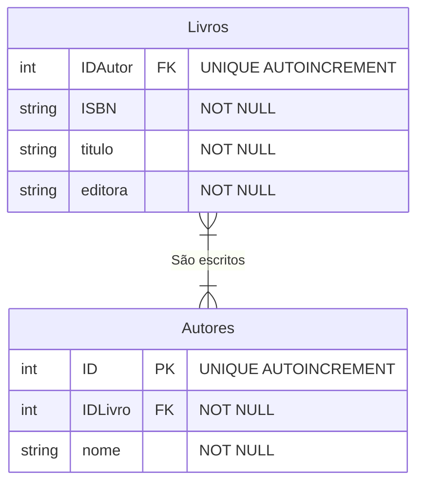
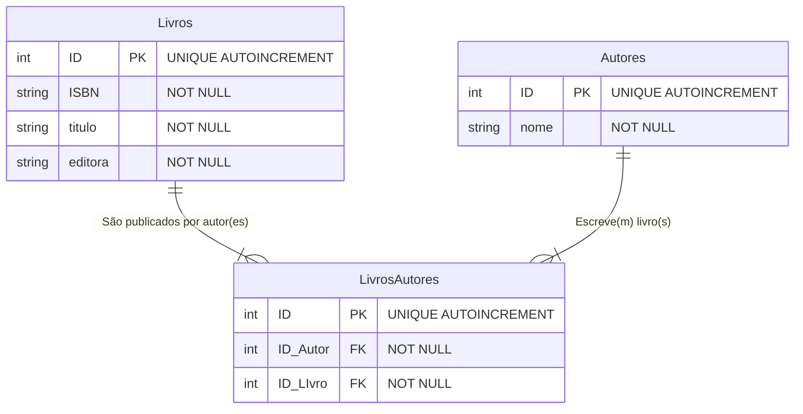

### Exercício 2: Catálogo de Livros e Autores  
#### Cenário: Um sistema de biblioteca exibe os dados assim:  
*View_Livros: ISBN, Titulo, Autores, Editora*  

_Dados: 978-85, "Banco de Dados", "C.J. Date, Abraham Silberschatz", "Pearson"_

*Tarefa: Um livro pode ser escrito por vários autores e um autor pode escrever vários livros. Crie o diagrama no Mermaid aplicando a normalização (incluindo a tabela associativa/intermediária).*  

#### Primeira solução  

#### Segunda solução - Com 3 Entidades

